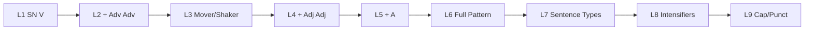

# Chapter 2 Instructional Map

**Date:** 2026-07-26  
**Branch:** `phase-3/chapter-02-gold-standard`  
**Purpose:** Complete instructional alignment for all 9 Chapter 2 lessons — concepts, patterns, Q&A flow, visuals, and packet sections.

---

## Chapter Arc Overview

| Phase | Lessons | Pattern | New Concept |
|-------|---------|---------|-------------|
| Foundation | 1 | SN V (P1) | Nouns, verbs, subject questions |
| Adverbs | 2–3 | SN V Adv Adv | Adverb questions, modification, Mover/Shaker |
| Adjectives | 4 | Adj Adj SN V Adv Adv | Three adjective questions |
| Articles | 5 | A Adj Adj SN V Adv Adv | a, an, the |
| Integration | 6 | Full pattern | Classification fluency |
| Sentence kinds | 7–8 | Full pattern + types | D/Imp/Int/E, intensifiers |
| Editing | 9 | Full pattern + cap/punct | Rule-number exercise |

---

## Abbreviation and Label Reference

| Abbrev | Full Name | When Introduced | Question(s) |
|--------|-----------|-----------------|-------------|
| **SN** | Subject Noun | L1 | Who? / What? |
| **V** | Verb | L1 | What is being said about the subject? |
| **Adv** | Adverb | L2 | How? / When? / Where? |
| **Adj** | Adjective | L4 | What kind? / Which one? / How many? |
| **A** | Article Adjective | L5 | *(memorize: a, an, the)* |
| **P1** | Pattern 1 | L1 | SN V |
| **D** | Declarative | L7 | Statement |
| **Imp** | Imperative | L7 | Command |
| **Int** | Interrogative | L7 | Question |
| **E** | Exclamatory | L7 | Strong feeling |

---

## Question and Answer Flow (Q&A Flow)

**Official name in slides:** Interrogation Protocol / Q&A Flow

### Universal Sequence

1. **Ask for subject first** — Who? or What? → label **SN**
2. **Ask for verb** — What is being said about [subject]? → label **V**
3. **For adverbs** — Go to the verb; ask How? / When? / Where? → label **Adv**
4. **For adjectives** — Go to the subject noun; ask What kind? / Which one? / How many? → label **Adj**
5. **For articles** — Identify a, an, the before the noun phrase → label **A**
6. **End Mark Flow** (L7+) — Identify end mark → feeling/purpose → sentence type → label D/Imp/Int/E

### Oral Skill Check Script (from slides)

> *"[End mark], [feeling/purpose], [sentence type name]. It is labeled [abbreviation]."*

Example: *"Exclamation point, strong feeling, exclamatory sentence. It is labeled E."*

### The Divide

Place a vertical slash **directly in front of the verb** to separate subject from predicate during classification.

---

## Sentence Classification Patterns

| Pattern | Label | Lessons | Example (Guided Notes) |
|---------|-------|---------|------------------------|
| SN V | P1 | 1 | Ships sailed. |
| SN V Adv Adv | — | 2–3 | Ships sailed slowly away today. |
| Adj Adj SN V Adv Adv | — | 4 | Those five cargo ships sailed slowly away today. |
| A Adj Adj SN V Adv Adv | — | 5–9 | The five cargo ships sailed slowly away. |

**Write-your-own prompts:** Lessons 1–5 (one per lesson).

---

## Lesson 1 — Nouns, Verbs, Pattern 1

### Confirmed Concepts

| Concept | Detail | Source |
|---------|--------|--------|
| Noun | Names person, place, thing, idea | T2, T3 |
| Subject noun | Who or what sentence is about | T2, T3 |
| Verb | Action or state of being | T2, T3 |
| Pattern 1 | SN V / P1 | T2, T3 |
| Q&A Flow | Subject first, then verb | T3 |

### Guided Notes Content

- Learn: noun categories (4 blanks), subject questions, verb types
- S. Ships sailed.
- Practice: Plane flew. / Ladybugs crawled. / Boys raced.
- Apply: Write your own SN–V sentence

### Visual Resources

| Resource | File | Packet Connection |
|----------|------|-------------------|
| Core Five grammar reference | `visuals/Core_Five_English_Grammar_Guide.png` | Reference insert / L1 Learn sidebar |
| Sentence Blueprint | `slides/Sentence_Blueprint.pptx` | L1 Practice Together — Q&A walkthrough |
| Operation Pattern 1 | `slides/Operation_Pattern_1.pptx` | L1 opening — detective theme, SN/V profiles |

### Teacher Presentation Sequence

1. Operation Pattern 1 — detective intro, SN/V profiles, Interrogation Protocol
2. Core Five poster — establish color coding
3. Sentence Blueprint — guided Q&A on *Ships sailed.*
4. Practice Together — *Plane flew.* / *Ladybugs crawled.* / *Boys raced.*
5. Apply — student write-your-own
6. Memory Check + Teacher Check

### Packet Sections

| Section | Content |
|---------|---------|
| Learn | Noun categories, subject questions, verb types, P1 definition |
| Practice Together | S. + 3 numbered sentences with classification lines |
| Apply | Write-your-own SN–V |
| Memory Check | Recall SN, V, P1 |
| Teacher Check | Signature line |

---

## Lesson 2 — Adverbs

### Confirmed Concepts

| Concept | Detail | Source |
|---------|--------|--------|
| Adverb questions | How? / When? / Where? | T1, T2, T3 |
| Adverbs modify | Verbs, adjectives, adverbs | T3 |
| Abbreviation | Adv | T1 |
| Pattern | SN V Adv Adv | T1 |

### Guided Notes Content

- Learn: adverb definition, three questions, what adverbs modify
- S. Ships sailed slowly away today.
- Practice: Planes flew. / Planes flew quickly away today. / Spiders crawled around very quickly.
- Apply: Write your own SN–V–Adv–Adv sentence

### Visual Resources

| Resource | File | Packet Connection |
|----------|------|-------------------|
| Adverb Blueprint | `slides/Adverb_Blueprint.pptx` | L2 Learn + Practice Together |

### Teacher Presentation Sequence

1. Adverb Blueprint title — three questions
2. What adverbs modify (verb / adjective / adverb)
3. Q&A flow — go to verb, ask adverb questions
4. Guided practice on Guided Notes sentences
5. Oral discussion slides
6. Classroom Practice 5 preview (slide-only sentences — oral only)
7. Apply + checks

### Packet Sections

| Section | Content |
|---------|---------|
| Learn | Adv definition, questions, modification targets |
| Practice Together | S. + 3 numbered |
| Apply | Write-your-own |
| Memory Check | Adv questions |
| Teacher Check | Signature |

---

## Lesson 3 — Adverb Classification + Mover/Shaker

### Confirmed Concepts

| Concept | Detail | Source |
|---------|--------|--------|
| Mover & Shaker | Move adverb to front; comma after | T3 |
| Inspector's Checklist | Subject, Verb, Complete Sense, Capital, End Mark | T3 |
| Classification focus | No new Learn text | T1 |

### Guided Notes Content

- Practice only: Bees buzzed angrily around today. / Rabbits hopped around everywhere. / Anthony listened very carefully yesterday.
- Apply: Write your own SN–V–Adv–Adv sentence

### Visual Resources

| Resource | File | Packet Connection |
|----------|------|-------------------|
| Sentence Blueprint | `slides/Sentence_Blueprint.pptx` | Review Q&A flow |
| The Grammar Blueprint-3 | `slides/The_Grammar_Blueprint-3.pptx` | Mover/Shaker rule, Inspector's Checklist |

### Teacher Presentation Sequence

1. Review adverb classification (Grammar Blueprint)
2. Mover/Shaker demonstration + comma rule
3. Inspector's Checklist oral review
4. Practice Together — 3 sentences
5. Apply + checks

### Packet Sections

| Section | Content |
|---------|---------|
| Learn | Mover/Shaker rule (brief callout box) |
| Practice Together | 3 numbered sentences |
| Apply | Write-your-own |
| Memory Check | Mover/Shaker comma rule |
| Teacher Check | Signature |

---

## Lesson 4 — Adjectives

### Confirmed Concepts

| Concept | Detail | Source |
|---------|--------|--------|
| Definition | An adjective describes a noun or a pronoun | T1 |
| Questions | What kind? / Which one? / How many? | T1, T2, T3 |
| Abbreviation | Adj | T1 |
| Q&A flow | Go to subject noun; ask adjective questions | T3 |
| Pattern | Adj Adj SN V Adv Adv | T1 |

### Guided Notes Content

- Learn: definition, three questions
- S. Those five cargo ships sailed slowly away today.
- Practice: That owl flew silently. / That large white owl flew silently overhead tonight. / Several little red ladybugs crawled everywhere yesterday.
- Apply: Write your own full-pattern sentence

### Visual Resources

| Resource | File | Packet Connection |
|----------|------|-------------------|
| Adjective Blueprint | `slides/Building_Adjective_Blueprints.pptx` | L4 Learn + Practice Together |

### Teacher Presentation Sequence

1. Building Adjective Blueprints — three questions
2. Oral discussion — go to subject noun
3. Guided Q&A on sample sentence
4. Practice Together — 3 sentences
5. Apply + checks

### Packet Sections

| Section | Content |
|---------|---------|
| Learn | Adj definition, three questions |
| Practice Together | S. + 3 numbered |
| Apply | Write-your-own full pattern |
| Memory Check | Adj questions |
| Teacher Check | Signature |

---

## Lesson 5 — Article Adjectives

### Confirmed Concepts

| Concept | Detail | Source |
|---------|--------|--------|
| Articles | a, an, the | T1, T2, T3 |
| Abbreviation | A | T1 |
| Also known as | Noun markers | T2, T3 |
| a/an rule | Consonant → a; vowel sound → an | T3 |
| Pattern | A Adj Adj SN V Adv Adv | T1 |

### Guided Notes Content

- Learn: article list, abbreviation, also-known-as blanks
- a/an practice: 9 sentences
- S. The five cargo ships sailed slowly away.
- Practice: The girls giggled loudly. / The four happy girls giggled loudly today. / A huge whale swam very slowly away.
- Apply: Write your own full-pattern sentence

### Visual Resources

| Resource | File | Packet Connection |
|----------|------|-------------------|
| Article Adjective Blueprint | `slides/Article_Adjective_Blueprint.pptx` | L5 Learn + a/an practice |

### Teacher Presentation Sequence

1. Article Adjective Blueprint — a, an, the blocks
2. a/an system check (9 Guided Notes sentences)
3. Guided Q&A on sample
4. Practice Together — 3 sentences
5. Apply + checks

### Packet Sections

| Section | Content |
|---------|---------|
| Learn | A definition, a/an/the, noun markers |
| a/an Practice | 9-sentence drill |
| Practice Together | S. + 3 numbered |
| Apply | Write-your-own |
| Memory Check | Articles list |
| Teacher Check | Signature |

---

## Lesson 6 — Full-Pattern Classification

### Confirmed Concepts

| Concept | Detail | Source |
|---------|--------|--------|
| Focus | Fluency — no new Learn text | T1 |
| Pattern | A Adj Adj SN V Adv Adv | T1 |
| Classroom Practice | Preview slide "Time to Build!" | T3 |

### Guided Notes Content

- Practice: The nice young doctor spoke very kindly today. / A little yellow duck waddled slowly away. / An enormous black bug flew around today.

### Visual Resources

| Resource | File | Packet Connection |
|----------|------|-------------------|
| Sentence Construction Blueprint | `slides/The_Sentence_Blueprint.pptx` | L6 Construction Site series |

### Teacher Presentation Sequence

1. The Sentence Blueprint — Construction Site theme
2. Full-pattern specimens from slides
3. Practice Together — 3 Guided Notes sentences
4. Classroom Practice 6 preview (oral)
5. Teacher Check

### Packet Sections

| Section | Content |
|---------|---------|
| Practice Together | 3 numbered sentences (generous lines) |
| Memory Check | Full pattern recall |
| Teacher Check | Signature |

---

## Lesson 7 — Vocabulary, Sentence Types, Extended Classification

### Confirmed Concepts

| Concept | Detail | Source |
|---------|--------|--------|
| Sentence types | Declarative, Imperative, Interrogative, Exclamatory | T1 |
| Labels | D, Imp, Int, E | T2, T3 |
| End Mark Flow | End mark → feeling → type → label | T3 |
| The Divide | Slash before verb | T3 |
| Analogy type | Rhyming | T1 |
| Parts of Speech | Four blanks (Noun, Verb, Adjective, Adverb proposed) | T4 |

### Guided Notes Content

- Vocabulary template (blank)
- Analogy: soothing : smoothing :: flying : trying → rhyming
- Learn: four sentence type definitions + label blanks; Parts of Speech row
- S. The two pirate ships appeared quite suddenly!
- Practice: The music played softly. / The very soothing music played softly tonight. / Several urgent messages arrived very early today.

### Visual Resources

| Resource | File | Packet Connection |
|----------|------|-------------------|
| Four kinds of sentences | `slides/Sentence_Construction_Blueprint.pptx` | L7 Learn |
| Analogy Codebreaker | `slides/Analogy_Codebreaker.pptx` | L7 vocabulary/analogy |
| Mastering poster | `visuals/Mastering_the_Sentence_Blueprint.png` | Reference — sentence types |

### Teacher Presentation Sequence

1. Sentence Construction Blueprint — four kinds chart
2. End Mark Flow + Skill Check oral script
3. The Divide demonstration
4. Analogy Codebreaker — rhyming relationship
5. Practice Together — 3 sentences + type labels
6. Vocabulary template assignment
7. Teacher Check

### Packet Sections

| Section | Content |
|---------|---------|
| Vocabulary | Blank template + analogy |
| Learn | Four sentence types + Parts of Speech |
| Practice Together | S. + 3 numbered with type labels |
| Memory Check | D/Imp/Int/E definitions |
| Teacher Check | Signature |

---

## Lesson 8 — Vocabulary, Sentence-Type Classification + Intensifiers

### Confirmed Concepts

| Concept | Detail | Source |
|---------|--------|--------|
| Intensifiers | very, extremely → Adv modifying Adj | T1, T3 |
| Analogy type | Synonym | T1 |
| Sentence-type labels | D, Imp, Int, E on all practice | T1 pattern |

### Guided Notes Content

- Vocabulary template (blank)
- Analogy: urgent : important :: answer : reply → synonym
- Practice: A young reporter glanced curiously around. / The stormy winter sky darkened suddenly! / An extremely frightened girl screamed very loudly!

### Visual Resources

| Resource | File | Packet Connection |
|----------|------|-------------------|
| Intensifier specimens | `slides/Sentence_Construction_Blueprint.pptx` | L8 Practice — *very* as Adv→Adj |
| Analogy Codebreaker | `slides/Analogy_Codebreaker.pptx` | L8 synonym analogy |
| Noun Checks | *(not found as titled slide)* | Teacher oral — document in teacher notes |

### Teacher Presentation Sequence

1. Review End Mark Flow
2. Intensifier labeling — *very* / *extremely* as Adv modifying Adj
3. Noun Checks (oral classroom procedure — teacher supplies script)
4. Analogy Codebreaker — synonym
5. Practice Together — 3 sentences
6. Vocabulary assignment
7. Teacher Check

### Packet Sections

| Section | Content |
|---------|---------|
| Vocabulary | Blank template + analogy |
| Practice Together | 3 numbered with full classification + type |
| Memory Check | Intensifier rule |
| Teacher Check | Signature |

---

## Lesson 9 — Full Classification + Cap/Punct

### Confirmed Concepts

| Concept | Detail | Source |
|---------|--------|--------|
| Cap/punct exercise | Rule numbers for bold corrections | T1 |
| Bold marks | N, comma, A, J, F, period | T1 |
| Reference | Chapter 1 cap/punct PDF | Ch. 1 protected |
| Revision/editing | Classroom Practice 10 slide | T3 (teacher-created) |

### Guided Notes Content

- Practice: Two beautiful butterflies flew slowly away. / An old teapot whistled very loudly today. / Several angry bees circled around nearby!
- Cap/punct: `No, Alex did not go home with John during carpool on Friday.` → **N**, **,**, **A**, **J**, **F**, **.**

### Visual Resources

| Resource | File | Packet Connection |
|----------|------|-------------------|
| Revision/editing | `slides/Sentence_Construction_Blueprint.pptx` | L9 teacher notes only (slide example) |
| Noun Checks | *(oral)* | Teacher notes |
| Classroom Practice 10 | Same deck | Preview + answer slides (oral) |

### Teacher Presentation Sequence

1. Full-pattern classification review — 3 sentences
2. Cap/punct rule-number exercise (use Ch. 1 reference)
3. Classroom Practice 10 preview (oral — do not embed slide sentence in packet)
4. Editing demonstration (teacher notes)
5. Teacher Check

### Packet Sections

| Section | Content |
|---------|---------|
| Practice Together | 3 numbered full classification |
| Cap/Punct | Rule-number exercise with bold marks |
| Memory Check | Reference pointer to Ch. 1 |
| Teacher Check | Signature |

---

## Assessment Connection Summary

| Lesson | Formative Check | Summative Tie-In |
|--------|-----------------|------------------|
| 1 | Memory Check: SN, V, P1 | In-Class Review sentences |
| 2 | Memory Check: Adv questions | — |
| 3 | Mover/Shaker recall | — |
| 4 | Memory Check: Adj questions | — |
| 5 | a/an drill + Memory Check | — |
| 6 | Full-pattern fluency | — |
| 7 | Sentence type labels | In-Class Review |
| 8 | Intensifier + type labels | In-Class Review |
| 9 | Cap/punct rule numbers | In-Class Review + Ch. 2 assessment |

---

## Official vs Teacher-Created Content

| Content | Tier | Use in Packet |
|---------|------|---------------|
| Guided Notes sentences (28) | T1 Official | Yes — all practice |
| Guided Notes definitions/templates | T1 Official | Yes |
| Visual PNG posters | T2 Official artwork | Yes — adapt for reference |
| Slide Q&A flow, marking conventions | T3 Instructional | Teacher notes + adapted diagrams |
| Slide Classroom Practice sentences | T3 Teacher-created | Oral only — not in packet |
| Slide analogy extras | T3 Teacher-created | Do not copy beyond L7/L8 source lines |
| Proposed fill-in answers | T4 Pending | Teacher approval required |

---

**See also:** `phase-3-source-audit.md`, `slide-to-packet-map.md`, `visual-language-guide.md`
